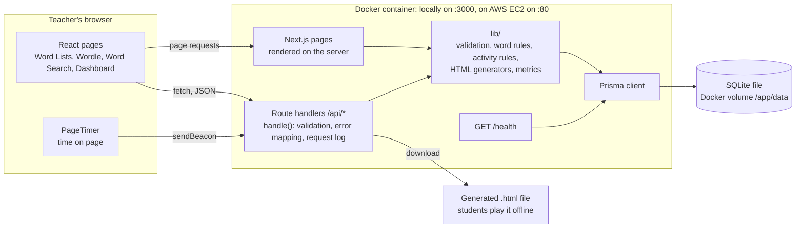
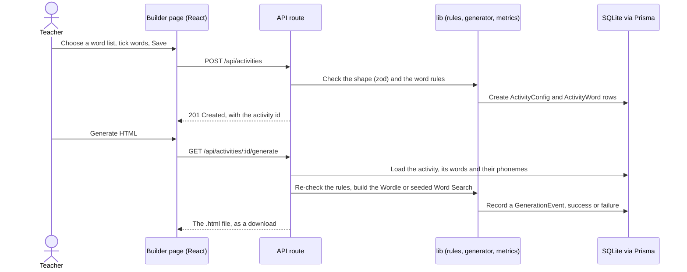
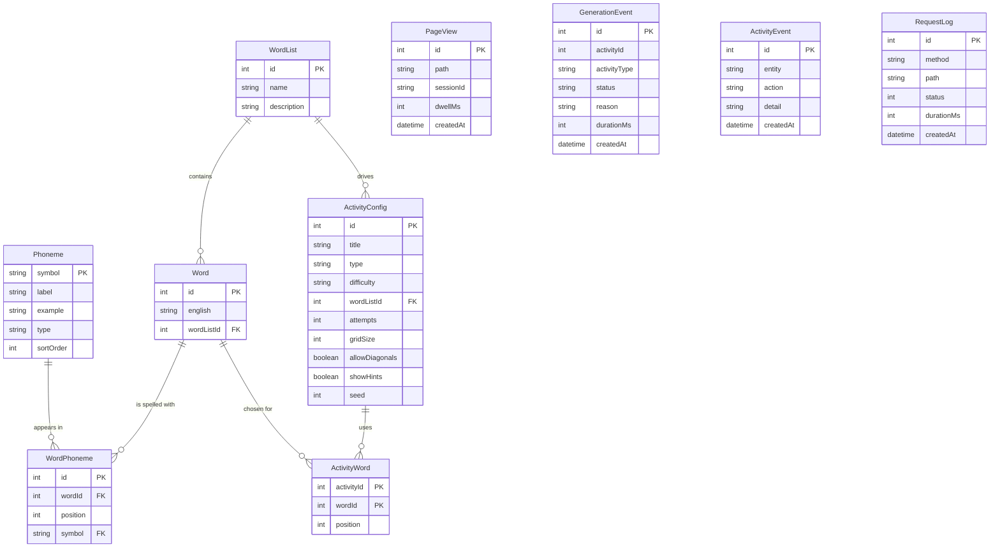

# Phoneme Activity Builder

**Assessment 3: Data-driven Application and Reporting**
Reed Stelfox · Student No. 22813726 · CSE3CWA

A Next.js application that lets Speech Pathology teachers build phoneme-based
**Wordle** and **Word Search** classroom activities, store their word lists
and activity settings in a database, and generate each activity as a single
playable `.html` file that runs in any web browser.

Assessment 1 built the frontend. Assessment 2 added the backend: a Prisma
schema on SQLite, a validated REST API with full create, read, update and
delete (CRUD), server-side HTML generation from stored data, a `/health`
endpoint, and a Docker image. Assessment 3 makes it data-driven: the
application now records what it does, and a dashboard reports usage, health
and failures over time, supported by end-to-end tests, load tests and
accessibility audits. The project was created with `npx create-next-app .`
and extended from there.

---

## Architecture



Everything runs in one Next.js application in one container. The browser
never touches the database: pages call the REST API, every route goes through
the same `handle()` wrapper (validation, consistent JSON errors, request
timing), the rules live in plain modules in `lib/` so they can be tested and
reused, and Prisma is the only code that talks to SQLite. The database file
sits in a Docker volume, so it survives restarts and rebuilds.

### How a word list becomes a playable activity



The rules are checked again at generation time because a word can be edited
or deleted after an activity is saved. The Word Search seed is stored, so the
downloaded puzzle is exactly the one the teacher previewed.

### How the project evolved

| Stage | Git tag | What changed | Why |
| --- | --- | --- | --- |
| Assessment 1 | `a1-submission` | Frontend only: the builders, the phoneme keyboard, and an HTML file built in the browser from form values | The first goal was a usable interface for teachers |
| Assessment 2 | `a2-submission` | Prisma on SQLite, a validated REST API, server-side generation from stored data, Docker | Work had to persist, and the generated file had to match what is stored |
| Assessment 3 | `a3-submission` | Reporting tables, instrumentation, the dashboard, Playwright, JMeter and Lighthouse | To show the system is healthy and used, and to find its limits |
| Assessment 4 | `a4-submission` | A short cache on the dashboard, and deployment to AWS EC2 | The load test showed the dashboard failing first; deployment follows the unit labs |

Smaller changes along the way: a Wordle target column became the
`ActivityWord` join table (the migration copies existing data across), the
Dockerfile was rewritten to follow the Workshop 6 lab pattern, and the
phoneme keys were fixed after Lighthouse flagged a WCAG 2.5.3 failure.

## Quick start (local)

Requires Node.js 22 or newer.

```bash
npm install        # also runs "prisma generate"
npm run setup      # creates the SQLite database, applies migrations, seeds data
npm run dev        # http://localhost:3000
npm run simulate   # optional: writes 14 days of simulated usage for the dashboard
```

`npm run db:seed` resets the data to the seeded state at any time, and
`npm run db:studio` opens Prisma Studio to browse the tables.

## Run with Docker

```bash
docker compose up --build
```

Then open http://localhost:3000 and check http://localhost:3000/health.

Without Compose:

```bash
docker build -t phoneme-activity-builder .
docker run -p 3000:3000 -v phoneme-data:/app/data phoneme-activity-builder
```

On start-up the container applies any pending migrations, seeds a brand-new
database with the course word lists, then starts the server. The database
file lives in the `phoneme-data` volume, so saved work survives restarts and
rebuilds. `docker compose down -v` deletes the volume for a clean start.

The Dockerfile follows the pattern from the unit's Workshop 6 lab: a build
stage and a production stage on `node:lts-alpine`, `tini` as the entrypoint
for proper signal handling, and `npm start`. The database steps follow the
Workshop 7 lab: `prisma generate` runs at build time, and `entrypoint.sh`
applies the migrations each time the container starts. `npm ci` installs the
exact versions in `package-lock.json`, so every build is the same, and a
`HEALTHCHECK` calls `/health`.

## Pages

| Route         | Purpose                                                                        |
| ------------- | ------------------------------------------------------------------------------ |
| `/`           | Home: introduction and links to the tools                                      |
| `/word-lists` | Create, rename and delete word lists; add, edit, delete and bulk-import words |
| `/wordle`     | Build, save, load and delete Wordle activities; generate the HTML file         |
| `/wordsearch` | Build, save, load and delete Word Search activities; generate the HTML file    |
| `/dashboard`  | Reporting and monitoring: usage statistics, alerts, charts and a CSV export   |
| `/about`      | Project explanation, author details and the how-to-use video                  |
| `/settings`   | Light, dark or system theme and layout density, stored in cookies             |

## Deploying to AWS EC2

The app deploys the way the unit's Workshop 6 and 7 labs deploy: Docker on an
EC2 instance in the AWS Academy Learner Lab, with the instance's port 80
mapped to the app.

1. Start the Learner Lab and open the AWS console.
2. EC2, **Launch instance**:
   - **AMI:** Amazon Linux 2023
   - **Instance type:** `t3.medium` (`t3.small` also works; a `t2.micro` works
     too but builds slowly)
   - **Key pair:** `vockey`
   - **Network settings:** allow SSH, and tick **Allow HTTP traffic from the
     internet**
   - **Storage:** 20 GiB
   - **Advanced details, User data:** paste the whole of
     [`deploy/ec2-user-data.sh`](deploy/ec2-user-data.sh)
3. Launch, wait about eight minutes for the first build, then open
   `http://<Public IPv4 DNS>/`. Use `http`, not `https`.

The user-data script runs the lab's own steps on first boot (Docker, Buildx,
Docker Compose, Git), clones this repository and runs
`APP_PORT=80 docker-compose up -d --build`. It also adds swap so a small
instance can finish the Next.js build. Its progress is in
`/var/log/phoneme-setup.log`, and the app's own logs are in
`docker logs phoneme-activity-builder`.

**A fixed address.** An instance's public IP normally changes every time it
stops and starts. Allocating an **Elastic IP** (EC2, Elastic IP addresses,
Allocate, then Associate it with the instance) keeps the address the same
across lab sessions. The deployed copy for this project is at
`http://100.29.214.254`, reachable while a Learner Lab session is running.

**Learner Lab limits.** A lab session lasts four hours and stops the instance
when it ends. Starting the lab again restarts the instance and Docker brings
the container back by itself (`restart: unless-stopped`). The database lives
in a Docker volume on the instance's disk, so saved data survives a restart.
It is plain HTTP on one instance with SQLite; production use would add HTTPS
with a domain name and PostgreSQL.

## Dashboard and observability

`/dashboard` is the reporting view. Everything on it is read from the
database; nothing is estimated in the browser.

| Panel | What it answers |
| --- | --- |
| Health strip | Is the app up, how fast did the database reply, how long has it been running |
| Alerts | Failed generations in the last 24 hours, empty word lists, activities that can no longer generate |
| Statistic cards | Activities stored by type, files generated, failures and success rate, average time on page, most-used activity type, API requests and error rate, stored totals |
| Daily chart | Activities created and generation outcomes for each of the last 7, 14 or 30 days, with a screen-reader table of the same numbers |
| Reporting tables | Time on page per page, slowest endpoints, recent failures with their reasons, recent changes |

What gets recorded, and where:

| Record | Written when | Table |
| --- | --- | --- |
| API call: method, path, status, duration | Every request through the shared route wrapper | `RequestLog` |
| Generation attempt: type, outcome, reason, duration | Every call to the generate endpoint, successful or not | `GenerationEvent` |
| Create, update or delete | Every write to a list, a word or an activity | `ActivityEvent` |
| Time on page | When a page is hidden, closed or left, using `sendBeacon` | `PageView` |

Recording never blocks a request: the writes are fire and forget, and
`METRICS_DISABLED=1` turns them off for a clean load-test baseline. No
personal data is stored, only a random per-tab id, a path and a duration.

`npm run simulate` writes a realistic history so the reporting views have
something to show on a fresh install.

## API reference

Every error response has the same shape, so the interface can show a headline
and the specific problems:

```json
{ "error": "Unknown phoneme symbol(s)", "details": ["\"rat\": \"r\" is not an HCE phoneme. Did you mean /ɹ/ (as in ring)?"] }
```

| Method   | Path                                 | Purpose                                                         |
| -------- | ------------------------------------ | --------------------------------------------------------------- |
| `GET`    | `/health`                            | 200 OK with database latency and stored counts, 503 if the database is down |
| `GET`    | `/api/metrics/summary?days=14`       | Everything the dashboard shows, as JSON                         |
| `GET`    | `/api/metrics/report?days=14`        | The same figures as a CSV download                              |
| `POST`   | `/api/metrics/page-view`             | Browser beacon recording how long a page stayed open            |
| `GET`    | `/api/phonemes`                      | The 43-symbol HCE phoneme inventory                             |
| `GET`    | `/api/word-lists`                    | All word lists with word and activity counts                    |
| `POST`   | `/api/word-lists`                    | Create a list, optionally with initial words                    |
| `GET`    | `/api/word-lists/:id`                | One list with all of its words and phonemes                     |
| `PATCH`  | `/api/word-lists/:id`                | Rename a list or change its description                         |
| `DELETE` | `/api/word-lists/:id`                | Delete a list, its words and the activities that use it         |
| `POST`   | `/api/word-lists/:id/words`          | Add one word, or bulk import `{ "words": [...] }` all-or-nothing |
| `GET`    | `/api/words/:id`                     | One word                                                        |
| `PATCH`  | `/api/words/:id`                     | Change a word's spelling and/or replace its phonemes            |
| `DELETE` | `/api/words/:id`                     | Delete a word (it is also removed from any activity)            |
| `GET`    | `/api/activities?type=WORDLE`        | Saved activities, optionally filtered by type                   |
| `POST`   | `/api/activities`                    | Save a new Wordle or Word Search configuration                  |
| `GET`    | `/api/activities/:id`                | One saved activity with its words                               |
| `PATCH`  | `/api/activities/:id`                | Update any settings or the chosen words                         |
| `DELETE` | `/api/activities/:id`                | Delete a saved activity                                         |
| `GET`    | `/api/activities/:id/generate`       | Build the playable HTML file from the database (download)       |

Status codes: `200` read or update, `201` created, `400` invalid input,
`404` not found, `409` duplicate spelling, `500` unexpected server error
(logged, with a generic message to the client), `503` database unavailable.

## Database schema



- **Phoneme** is the reference inventory (43 HCE symbols). It holds the
  English letter hint and example word, so hover hints such as
  `/θ/: TH (as in thin)` come from the database.
- **WordPhoneme** stores one phoneme per row with its position. This is how
  the schema handles symbols longer than one character (`tʃ`, `dʒ`, `æɪ`,
  `əʉ`): each one is a single value with its own identity, and its foreign
  key to `Phoneme` means the database itself rejects unknown symbols.
- **Word** has a unique `(wordListId, english)` constraint, so a spelling
  cannot appear twice in one list.
- **ActivityConfig** stores a saved activity: type, difficulty label, hint
  setting and the output settings (guesses, grid size, diagonals, layout seed).
- **ActivityWord** is a join table recording which words an activity uses and
  in what order, so one list can drive many activities.
- Deleting a list cascades to its words and activities; deleting a word
  removes it from any activity that used it.

- **PageView, GenerationEvent, ActivityEvent** and **RequestLog** are the
  reporting tables added in Assessment 3. They are deliberately standalone,
  append-only logs with no foreign keys: an event is a record of something
  that happened, so deleting an activity must not delete the evidence that it
  was created, used or failed. `GenerationEvent.activityId` is a plain number
  for that reason, and each table is indexed on `createdAt` because every
  dashboard query filters by date.

Three migrations are included. The second shows schema evolution: it replaced
a single `targetWordId` column with the `ActivityWord` join table and copies
any existing target words across before the old column is dropped. The third
adds the four reporting tables.

## Validation and error handling

Validation happens on both sides, and the server is the authority.

1. **Shape** (zod, `lib/validation.ts`): types, required fields, lengths,
   ranges (3 to 8 guesses, 6 to 14 grid) and allowed values.
2. **Clean-up** (`lib/phoneme-normalize.ts`): typographic variants of the same
   symbol are normalised, for example the IPA script ɡ to g, a typed colon to
   the length mark ː, and the ʧ and ʤ ligatures to tʃ and dʒ.
3. **Database rules** (`lib/word-rules.ts`, `lib/activities.ts`): every
   phoneme must exist in the inventory table; spellings are unique per list;
   chosen words must exist and belong to the chosen list; a Wordle needs 1 to
   10 words of at least two phonemes; a Word Search needs 3 to 12 words that
   fit the grid.
4. **Friendly messages**: an unknown symbol gets a suggestion, such as
   `"r" is not an HCE phoneme. Did you mean /ɹ/ (as in ring)?`, and bulk
   import errors are numbered by word.
5. **Graceful failure**: malformed JSON, bad ids, missing records and words
   deleted after an activity was saved all return a clear 4xx message instead
   of a crash. Unexpected errors are logged and return a generic 500.

In the browser the phoneme keyboard can only produce valid symbols, and the
bulk import previews problems line by line before anything is sent.

## Testing and audits

Four checks, each answering a different question.

### 1. API smoke test: does every endpoint behave?

```bash
npm run test:api
```

`scripts/api-smoke-test.ts` makes over 50 checks against the live API: health,
every CRUD route, phoneme normalisation, each validation rule, bulk import
atomicity, activity rules, HTML generation from stored data, and cascade
deletes. It creates its own list and removes it afterwards. Point it at
another server with `BASE_URL=http://host:port npm run test:api`.

### 2. Playwright: does it work in a real browser?

```bash
npm run test:e2e
```

Seven end-to-end tests in `e2e/` drive Chromium against a real server and a
real database. The dev server starts automatically if it is not already
running, and `npm run test:e2e:report` opens the HTML report.

| Test file | What it proves |
| --- | --- |
| `builder-crud.spec.ts` | A teacher can create a list, add a word with the phoneme keyboard, get a clear error when adding a duplicate, edit the word, see it survive a full page reload, then delete the word and the list. |
| `activity-generation.spec.ts` | Loading a saved activity and pressing Generate downloads an `.html` file, the file the server builds contains the stored title and words, and a missing activity returns 404 with a readable message instead of a crash. |
| `dashboard-observability.spec.ts` | The dashboard shows health and statistics, `/health` returns 200 with database status, and generating a file increases the success counter, which proves the whole loop from browser to database to report. |

### 3. JMeter: what happens under load?

`load-tests/phoneme-builder.jmx` gives each simulated user the same five
requests: the health check, the word lists API, the activities API,
generating an activity file, and the dashboard page. The user count is a
parameter, so one plan covers every load level:

```bash
jmeter -n -t load-tests/phoneme-builder.jmx -Jusers=100 -Jrampup=20 -Jloops=3 -l load-tests/results/run-100.csv
```

The measured results, and what they say about where the system starts to
struggle, are in `docs/evidence/load-test-results.md`.

### 4. Lighthouse: is it accessible?

```bash
npx lighthouse http://localhost:3000/dashboard --only-categories=accessibility --view
```

The dashboard, word lists and Wordle pages all score 100 for accessibility.
The audit still flagged one real problem: a phoneme key showed "/p/ P" while
its accessible name read "/p/: P (as in pond)", so somebody using speech
control could not say what they saw (WCAG 2.5.3, Label in Name). The keys now
announce exactly what is printed on them, and the chips that remove a phoneme
do the same. Before and after reports are in `docs/evidence/`.

## Project structure

```
app/
  api/                  REST API route handlers (word lists, words, activities, phonemes)
  health/route.ts       GET /health
  word-lists/ wordle/ wordsearch/ about/ settings/   Pages
components/
  wordlists/            Word list manager: sidebar, header, word editor, table, bulk import
  activities/           Shared builder pieces: useActivityBuilder hook, word picker,
                        difficulty picker, saved activities, save and generate panel
  wordle/ wordsearch/   Builders and playable previews
  phonemes/             Phoneme key, keyboard, builder and chips
  layout/ ui/           Header, navigation, footer, cards, alerts, buttons
lib/
  db.ts                 Prisma client singleton
  api.ts                Route helpers: JSON envelopes, error mapping, body parsing
  validation.ts         zod schemas
  word-rules.ts         Phoneme and spelling rules that need the database
  activities.ts         Activity serializer and word selection rules
  phoneme-normalize.ts  Normalisation, suggestions, tokeniser, bulk parser
  client-api.ts         Typed fetch helpers used by the pages
  generate/             Standalone HTML builders (Wordle, Word Search)
  phonemes.ts words.ts  HCE inventory and corpus (seed data)
prisma/
  schema.prisma         Data model
  migrations/           Versioned SQL migrations
  seed.ts               Seeds the inventory, corpus lists and example activities
  metrics.ts            Recording helpers and the dashboard aggregation
app/
  dashboard/            The reporting and monitoring page
  api/metrics/          summary (JSON), report (CSV), page-view (browser beacon)
components/
  dashboard/            Stat cards, alerts, tables and the daily chart
  observability/        PageTimer: how long each page stays open
scripts/
  api-smoke-test.ts     End-to-end API checks
  simulate-usage.ts     Writes a realistic usage history for the dashboard
e2e/                    Playwright tests (builder, generation, dashboard)
load-tests/             JMeter test plan
docs/evidence/          Lighthouse reports and load-test results
Dockerfile  docker-compose.yml  entrypoint.sh
```

## Repository workflow

- `main` holds the stable version that gets submitted.
- From Assessment 2 onwards each assessment's work lives on its own branch
  (`assessment-2`), built up in small, focused commits (database, API, pages,
  Docker, documentation) and merged into `main` with a merge commit, so the
  history shows where each piece of work came in. Assessment 1 was committed
  directly to `main`.
- Tags mark exactly what was submitted: `a1-submission` (frontend) and
  `a2-submission` (backend, database and Docker). View one with
  `git checkout a1-submission`.
- `node_modules`, build output, the local database file and the walkthrough
  video are kept out of the repository by `.gitignore`.

## The how-to-use video

The walkthrough video is embedded on the About page and loads from
`public/how-to-use.mp4`. **It is included in the submitted zip file but is
deliberately excluded from this public repository**, because the video shows
my student identification card as the brief requires, and identity documents
should not be published on a public site.

## Design justification

**Architecture.** The backend lives inside the same Next.js project as the
frontend, as route handlers under `app/api` (Vercel, n.d.). One codebase, one
build and one container kept the project simple to run and to mark, while
still separating concerns: pages never touch the database, they call a REST
API that follows Fielding's (2000) constraints of stateless requests and
resources identified by URLs. Each route is a thin layer that validates
input, calls shared logic in `lib/`, and returns a consistent JSON envelope.
Business rules (which words suit which activity, what makes a phoneme valid)
live in plain modules that are independent of HTTP, so they can be unit
tested in the next assessment and reused by the generator.

**Database design.** The schema is relational and normalised (Codd, 1970). The
central decision was how to store phonemes. The brief warns that phonemes can
take more than one character. Storing a word as the string "tʃɪn" would make
it impossible to know where one phoneme ends and the next begins, and storing
a comma-separated or JSON array would push integrity checks into application
code. Instead each phoneme is a row in `WordPhoneme`, with a position and a
foreign key into the `Phoneme` inventory. Multi-character HCE symbols
(Harrington et al., 1997) are single values, order is explicit, and the
database refuses a symbol that is not in the inventory. The inventory row also
holds the English letter hint, so the hints students see come from one place.
The same thinking produced the `ActivityWord` join table: an activity refers
to words rather than copying them, so fixing a transcription in the word list
fixes every activity that uses it. Constraints are pushed into the database
where possible: a unique spelling per list, a unique position per word, and
cascading deletes so no orphaned rows remain.

**ORM and migrations.** Prisma gives a typed client generated from the schema,
so a renamed column becomes a compile error rather than a runtime surprise,
and it produces versioned SQL migrations (Prisma Data, n.d.). The second
migration changed an existing column into a join table. Rather than accept
data loss, I edited the generated SQL to copy each existing Wordle target into
the new table before the old column was dropped, which is the kind of change a
real deployment has to survive.

**Validation and error handling.** Input is treated as untrusted and validated
on the server before anything is stored, using an allow-list of known
phonemes rather than a block-list of bad characters, as the OWASP Foundation
(n.d.) recommends. Validation is layered: zod checks shape and ranges, a
normalisation step accepts harmless typographic variants, and database-backed
rules check references and business logic. The messages follow Nielsen's
(1994) heuristic of helping users recognise, diagnose and recover from errors.
A teacher who types "r" is told that HCE writes the sound as ɹ, with an
example word, rather than receiving "invalid input". Bulk imports are
all-or-nothing inside a transaction, so a single bad line never leaves a list
half-imported. Unexpected errors are logged on the server and return a
generic message, so internal details are not leaked to the browser.

**Generation from stored data.** In Assessment 1 the browser built the HTML
from temporary form values. Now the Generate button saves the activity first
and the server builds the file from the database. The file therefore always
matches what is stored, and a word edited or deleted after saving is caught:
the activity rules run again at generation time and explain what needs
fixing. The Word Search layout is produced by a seeded generator, and the seed
is stored, so the downloaded puzzle is exactly the one previewed. Word lists
now drive the output: a Wordle can hold several words that students play in
order, and a Word Search can use any list.

**Docker.** Containers make the environment reproducible, so the app behaves
the same on a marker's machine as on mine (Merkel, 2014). The Dockerfile keeps
to the two-stage pattern taught in the Workshop 6 lab, a multi-stage build
(Docker Inc., n.d.): the build stage installs the packages and compiles the
app, and the production stage starts from a clean image and copies across only
the build output, the packages and the Prisma files, with tini passing
shutdown signals to the server. Installing with `npm ci` from the committed
lock file means every build gets the same package versions. Following the
Workshop 7 lab, a start-up script applies the Prisma migrations; it also seeds
only an empty database so a teacher's data is never overwritten. The database
lives in a volume, and the container reports its health through the `/health`
endpoint.

**Observability and reporting.** A system that works is not the same as a
system you can see working, so Assessment 3 adds a record of what the
application does: every API call with its status and duration, every
generation attempt with its outcome and the reason for any failure, every
create, update and delete, and how long each page stays open. These are
separate append-only tables rather than counters on the existing rows,
because a counter cannot answer "when" or "why", and deleting an activity
should not erase the fact that it once existed. Writes are fire and forget:
a metric that fails, or is slow, must never affect the teacher who triggered
it. The dashboard then answers the questions an operator actually asks,
close to the four signals Beyer et al. (2016) describe: is it up (health and
database latency), how much is it being used (activities, generations, page
views), how fast is it (average response time and the slowest endpoints) and
what is going wrong (failure counts with reasons, and alerts for empty lists
or activities that can no longer generate). Following Few (2006), the
numbers that need action sit at the top as plain figures with a short
explanation of each, rather than being decorated with gauges.

**Testing.** The three kinds of testing answer different questions and none
of them replaces another. The API smoke test checks contracts quickly,
Playwright drives a real browser so the interface and the database are
exercised together, and JMeter shows what happens when many people arrive at
once. The Playwright tests deliberately assert on a reload rather than on
what is on screen immediately after an action, because that is the
difference between "React updated" and "the database saved it".

**Accessibility.** Lighthouse was run on the pages a teacher uses most. The
score was already 100, but the report flagged a genuine mismatch between the
visible text on the phoneme keys and their accessible name, which WCAG 2.5.3
(W3C, 2023) exists to prevent: a speech-control user says what they see, so
the name has to start with the visible text. Fixing it was a two-line change
and made the keyboard usable by voice. The daily chart also carries a
screen-reader table with the same numbers, because a picture of the data is
no use to somebody who cannot see it.

**Trade-offs.** SQLite was chosen over PostgreSQL because it needs no separate
server, which keeps the app in a single container and simple to run for
marking; the cost is limited write concurrency, which suits one teacher's
workload. Prisma's schema file makes the SQLite to PostgreSQL move a small
change if the app is later deployed for many users. Keeping the API inside
Next.js avoids a second service but ties the backend to the framework, a
reasonable choice at this scale. Storing the difficulty as a label while
saving the concrete settings lets teachers fine-tune, at the cost of a label
that can drift from its preset.

**Supporting Speech Pathology teaching.** Teachers can now build their own
lists for the sounds a class is working on, keep and reuse activities, and
trust that phoneme transcriptions are checked against the HCE inventory used
in their course. Students still receive a simple file that runs offline, with
the phoneme-to-English hints reinforced on every key and every answer.

## References

Apache Software Foundation. (n.d.). *Apache JMeter user manual*. Retrieved
September 30, 2026, from https://jmeter.apache.org/usermanual/index.html

Beyer, B., Jones, C., Petoff, J., & Murphy, N. R. (2016). *Site reliability
engineering: How Google runs production systems*. O'Reilly Media.

Codd, E. F. (1970). A relational model of data for large shared data banks.
*Communications of the ACM, 13*(6), 377-387. https://doi.org/10.1145/362384.362685

Docker Inc. (n.d.). *Multi-stage builds*. Docker Docs. Retrieved September 11,
2026, from https://docs.docker.com/build/building/multi-stage/

Few, S. (2006). *Information dashboard design: The effective visual
communication of data*. O'Reilly Media.

Fielding, R. T. (2000). *Architectural styles and the design of network-based
software architectures* [Doctoral dissertation, University of California,
Irvine]. https://ics.uci.edu/~fielding/pubs/dissertation/top.htm

Google. (n.d.). *Lighthouse accessibility scoring*. Chrome for Developers.
Retrieved September 30, 2026, from
https://developer.chrome.com/docs/lighthouse/accessibility/scoring

Harrington, J., Cox, F., & Evans, Z. (1997). An acoustic phonetic study of
broad, general, and cultivated Australian English vowels. *Australian Journal
of Linguistics, 17*(2), 155-184. https://doi.org/10.1080/07268609708599550

Merkel, D. (2014). Docker: Lightweight Linux containers for consistent
development and deployment. *Linux Journal, 2014*(239), Article 2.
https://dl.acm.org/doi/10.5555/2600239.2600241

Microsoft. (n.d.). *Playwright: Writing tests*. Retrieved September 30, 2026,
from https://playwright.dev/docs/writing-tests

Nielsen, J. (1994, April 24). *10 usability heuristics for user interface
design*. Nielsen Norman Group. https://www.nngroup.com/articles/ten-usability-heuristics/

OWASP Foundation. (n.d.). *Input validation cheat sheet*. OWASP Cheat Sheet
Series. Retrieved September 11, 2026, from
https://cheatsheetseries.owasp.org/cheatsheets/Input_Validation_Cheat_Sheet.html

Prisma Data. (n.d.). *Prisma ORM documentation*. Retrieved September 11, 2026,
from https://www.prisma.io/docs/orm

Sridharan, C. (2018). *Distributed systems observability: A guide to building
robust systems*. O'Reilly Media.

Vercel. (n.d.). *Route handlers*. Next.js Docs. Retrieved September 11, 2026,
from https://nextjs.org/docs/app/getting-started/route-handlers

W3C. (2023). *Web Content Accessibility Guidelines (WCAG) 2.2*.
https://www.w3.org/TR/WCAG22/

## GitHub repository

https://github.com/ReedStel/phoneme-activity-builder
